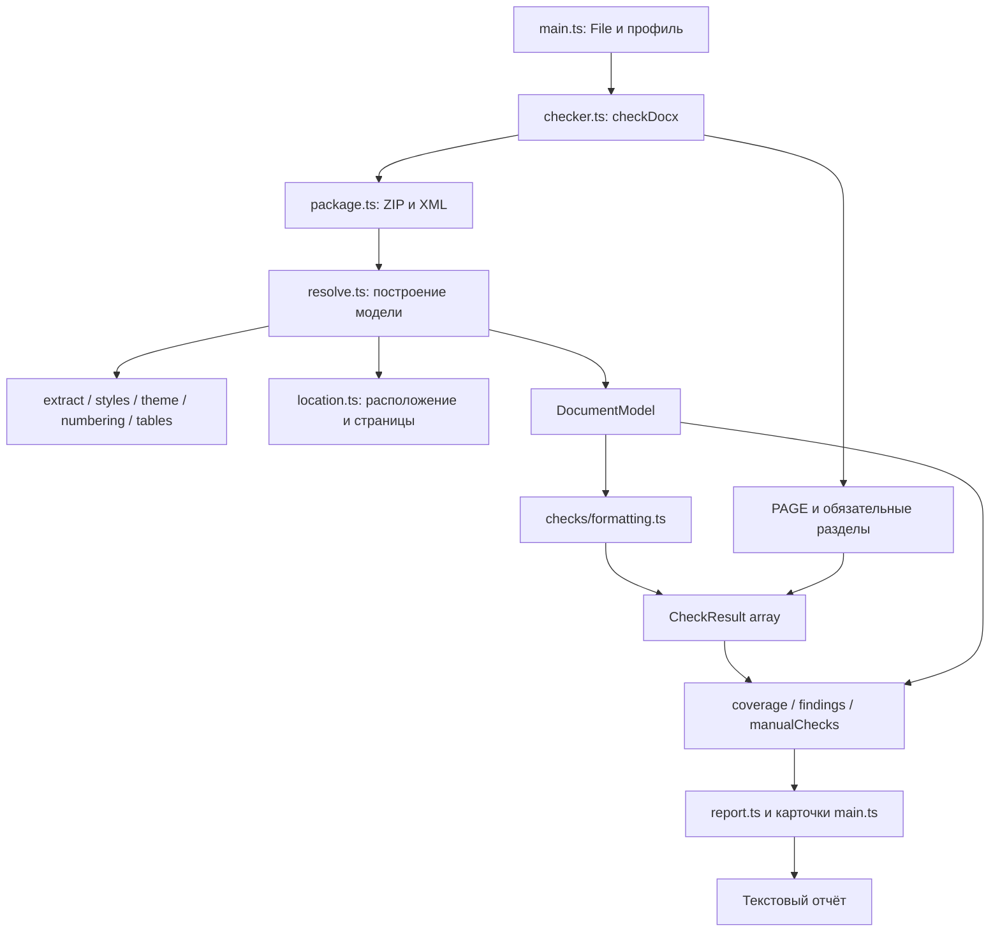

# Архитектура DockCheck

Документ описывает фактическую архитектуру версии **0.1.0**. Пользовательские
возможности, запуск и ограничения собраны в [README.md](README.md). Здесь
рассматриваются ответственность модулей, поток данных, контракты и точки развития.

## 1. Границы системы

DockCheck — клиентское приложение на TypeScript. Интерфейс работает напрямую с DOM,
без UI-фреймворка. Vite обслуживает разработку и собирает статические ресурсы.
DOCX разбирается локально как ZIP-пакет OOXML; сервер обработки документов отсутствует.

В текущей системе нет базы данных, фонового сервиса, очереди заданий, авторизации,
облачной обработки, движка вёрстки или записи исправленного DOCX. Word COM,
LibreOffice и коммерческие SDK не являются зависимостями анализа.

Анализ выполняется в основном потоке браузера. Web Worker, потоковая обработка
архива и отмена выполняющегося анализа пока не реализованы. Общий объём работы
зависит от количества XML-частей, абзацев, runs, стилей и условных областей таблиц.
Ограничение 25 МиБ применяется интерфейсом к входному файлу; публичный `checkDocx`
сам по себе не повторяет эту проверку и не является ограничителем распаковки ZIP.

## 2. Стек и зависимости

| Компонент | Ответственность |
| --- | --- |
| TypeScript | Типы модели, профиля и отчёта; strict-проверка при сборке |
| Vite | Dev server и сборка браузерного приложения |
| JSZip | Чтение ZIP-контейнера DOCX; генерация синтетических фикстур в тестах |
| `@xmldom/xmldom` | Разбор XML и DOM API, общий для браузера и Node-тестов |
| Vitest | Проверки анализатора, правил, диапазонов и экспорта в Node |
| Playwright, внешний для проекта | Отдельный сценарий проверки интерфейса в Chromium |

Точные установленные версии фиксирует `package-lock.json`. В `package.json`
указаны диапазоны зависимостей. Playwright в манифест проекта не добавлен.

## 3. Структура репозитория

```text
index.html                       # HTML-точка входа и контейнер приложения
src/
  main.ts                        # Состояние UI, события, загрузка и карточки
  styles.css                     # Оформление, адаптивность и фокус
  types.ts                       # Requirements, CheckResult, Finding, CheckReport
  checker.ts                     # Публичный checkDocx и сбор отчёта
  report.ts                      # Представление, группировка, текстовый экспорт
  profiles/
    default.ts                   # Начальный настраиваемый профиль
  checks/
    formatting.ts                # Сравнение DocumentModel с Requirements
  analyzer/
    model.ts                     # Свойства, runs, абзацы, секции, расположение
    package.ts                   # ZIP, XML, relationships и проверки упаковки
    extract.ts                   # Извлечение явных свойств и единиц
    properties.ts                # Наложение свойств и специальные каскады
    styles.ts                    # Индекс стилей, defaults, basedOn, переключатели
    theme.ts                     # Назначенные шрифты и тематические цвета
    numbering.ts                 # Определения и настройки списков
    tables.ts                    # Условные стили и прямая геометрия таблиц
    location.ts                  # Человекочитаемый путь и ориентиры страниц
    resolve.ts                   # Обход частей и построение DocumentModel
scripts/
  check-ui.mjs                   # Самостоятельный браузерный сценарий
tests/                           # Тесты и синтетические документы
  checker.test.ts                # Исходные сценарии и комплектные DOCX
  location.test.ts               # Диапазоны, страницы, поиск и экспорт
  resolution.test.ts             # Каскады, темы, таблицы, списки, поля и ограничения
  helpers.ts                     # Упаковка синтетического OPC для тестов
  fixtures/
    generate.mjs                 # correct / incorrect / partial
    generate-search.mjs          # search / textbox
    *.docx                       # Пять комплектных синтетических документов
vite.config.ts                   # Порты сервера и Node-среда тестов
tsconfig.json                    # strict, ES2022, DOM, noEmit
```

`AGENT.md` — локальное задание, исключённое из Git. Его не следует включать в
поставку или использовать вместо публичной документации. `dist/` — результат
сборки, а `node_modules/` — установленные зависимости.

## 4. Сквозной поток данных



Последовательность одного запуска:

1. `main.ts` проверяет расширение и размер файла, показывает состояние обработки
   и получает `ArrayBuffer` через File API.
2. `checkDocx` открывает пакет и передаёт его в `analyze`.
3. `analyze` читает связанные определения, обходит текстовые области, разрешает
   свойства и сохраняет расположение каждого анализируемого фрагмента.
4. После обхода уточняются контексты колонтитулов, подписи и ориентиры страниц.
5. `checks` сравнивает модель с профилем без доступа к XML.
6. `checker.ts` дополняет результаты проверками PAGE и обязательных разделов,
   подсчитывает статусы и создаёт совместимые представления замечаний.
7. UI фильтрует результаты и группирует их для показа. Экспорт заново проходит
   полный массив результатов, сохраняя успешные и неизвестные проверки.

Исключение на этапе открытия/разбора возвращается вызывающему коду. Интерфейс
перехватывает его, возвращает загрузку и показывает сообщение. Поддерживаемая
частичная неопределённость обычно становится unknown, а не исключением.

## 5. Публичный API и профиль

Точка входа экспортируется из `src/checker.ts`:

```ts
checkDocx(
  data: ArrayBuffer | Uint8Array,
  requirements: Requirements = DEFAULT_REQUIREMENTS,
): Promise<CheckReport>
```

Функция не принимает DOM-элементы и не открывает диалоги. Имя исходного файла
добавляет интерфейс в `report.fileName` после анализа. Время `checkedAt` создаётся
при сборке отчёта; поэтому полный отчёт не является побайтово детерминированным.

```ts
import { checkDocx, DEFAULT_REQUIREMENTS } from './src/checker';

const report = await checkDocx(bytes, {
  ...DEFAULT_REQUIREMENTS,
  textRoles: ['body', 'table'],
  fontSizePt: 14,
  requiredSections: ['ВВЕДЕНИЕ', 'ЗАКЛЮЧЕНИЕ'],
});

const failures = report.results.filter(result => result.status === 'fail');
```

`Requirements` содержит шрифт/кегль, допустимые множители интервала, отступ,
портретные поля, флаги A4/выравнивания/PAGE, обязательные разделы и `textRoles`.
Поле `requireContentsOverPages` сохранено для совместимости, но не порождает
проверку содержания: пагинация не установлена.

Профиль задаётся как полный `Requirements`, а не как частичное переопределение.
Именно UI объединяет сохранённые настройки с defaults. Для вложенных полей
используется существующая поверхностная логика загрузки настроек; универсальной
схемы валидации произвольного профиля сейчас нет.

## 6. Контракты модели

### 6.1. Свойства и происхождение

`ResolvedProperty<T>` содержит:

| Поле | Смысл |
| --- | --- |
| `value` | Нормализованное значение либо null |
| `status` | resolved / unknown / unsupported |
| `source` | Часть, свойство и при наличии styleId/nodeId |
| `unit` | Единица нормализованного значения |
| `raw` | Исходное значение атрибута, когда оно сохранено извлечением |
| `reason` | Причина неопределённости или пояснение назначения |

`Properties` — словарь свойств. `complete` добавляет отсутствующим ключам unknown;
он не подставляет шрифт, размер или отступ из требований. Булево false является
значением, а не отсутствием свойства.

Статус свойства и статус проверки различаются. Свойство может быть resolved,
но соответствие оставаться unknown, если область профиля не установлена.
Например, размер сноски известен, но роль `note` не выбрана для общего кегля.

`explicit` хранит извлечённые локальные свойства, `properties` — результат
разрешения. Происхождение составного значения сейчас ограничено одним `Source`:
полного дерева вкладов всех слоёв нет. Это особенно существенно для объединённых
табуляций и сложных каскадов.

### 6.2. Документ, абзац и run

`DocumentModel` содержит `paragraphs`, `sections`, `objects`, `unsupported`,
`limitations` и счётчики таблиц/рисунков.

`Paragraph` хранит текстовую проекцию, роль, идентификатор, расположение, runs,
явные/итоговые свойства, смещения сохранённых разрывов, признак PAGE и состояние
разбора полей. Роли: body, heading, table, footer, header, note, list, caption,
textbox, unknown. Классификация эвристическая и не доказывает семантику текста.

`Run` содержит собственный идентификатор, текст, расположение, свойства и
`fontRanges`. Последние позволяют проверять разные назначения шрифта внутри
одного run без потери исходных смещений. Размер шрифта проверяется на уровне run.

`Section` содержит свойства и словари действующих верхних/нижних колонтитулов.
`objects` сохраняет таблицы, строки, ячейки и обнаруженные drawing, включая
прямую геометрию и связь с кандидатом подписи. Это аналитическая модель, а не
схема для обратной сериализации всего DOCX.

`unsupported` хранит конкретные непроверенные объекты с расположением и причиной.
`limitations` — общие пояснения; отдельные причины могут присутствовать и в
объектном, и в общем представлении. Счётчики отчёта считают результаты правил,
а не уникальные причины или страницы документа.

### 6.3. Расположение и диапазоны

`DocumentLocation` — общее структурированное расположение:

- часть DOCX и область;
- XML-путь, если построен;
- paragraphId и номер абзаца внутри соответствующей области;
- storyId для отдельной текстовой истории;
- tablePath для вложенных таблиц с номерами строк/ячеек;
- fragmentId для run;
- секция либо sectionUses для повторно используемых колонтитулов;
- диапазон и отдельная ссылка на страницу.

Диапазон задаётся как `[start, end)` в **кодовых единицах UTF-16** исходной
анализируемой проекции абзаца. Это соответствует JavaScript `slice`.
Текст не trim-ится и не нормализуется перед расчётом. Emoji может занимать две
единицы; таб и разрыв строки сохраняются как `\t` и `\n`.

Цитата получается срезом по диапазону, а не поиском первого совпадения текста.
Идентификаторы служат для связи объектов внутри одного анализа; гарантии
сохранения идентификаторов после редактирования и повторного анализа файла нет.
Текст исключённых правок не входит в эту проекцию, а исключённая область
сохраняется отдельно. Исходная XML-позиция и текстовая позиция — разные понятия.

## 7. Упаковка и разбор XML

`package.ts` предоставляет чтение частей и helpers `children`, `all`, `child`,
`attr`. WordprocessingML выбирается по пространству имён, а не по XML-префиксу.

Основная часть ожидается по пути `word/document.xml`; root relationships должен
указывать на неё как officeDocument. Другие допустимые размещения основной части
не поддерживаются. Проверяются Content Types, основные типы relationships,
пространство имён relationships и корни поддерживаемых существующих частей.
Относительные Target нормализуются; выход выше корня пакета отклоняется.
Внешние relationships не загружаются.

`parse` собирает предупреждения и ошибки XML-парсера и отклоняет повреждённый XML.
Проверки упаковки не заменяют полную валидацию XML-схем и всех ограничений OPC.
Отсутствующая связанная часть может дать ограничение анализа; неверный Content Type
или корень существующей поддерживаемой части может прервать открытие пакета.

Чтение частей и разрешение некоторых стилей повторяются в нескольких местах;
универсального кэша и предварительно построенного индекса всех отношений нет.
Это точка оптимизации при работе с большими документами.

## 8. Разрешение оформления

### 8.1. Явные значения и единицы

`extract.ts` читает поддерживаемые свойства pPr/rPr/sectPr. Числовые атрибуты
проверяются на допустимую целочисленную запись и конечность. On/off-значения
отличаются от отсутствующих атрибутов: наличие spacing не означает включение
beforeAutospacing/afterAutospacing.

Основные преобразования: twips → мм, half-points → пт, twentieths of a point → пт.
Межстрочный `line` сохраняется с режимом; только `auto` сравнивается как `line/240`.
Исходная единица или смысл enum не должны подменяться миллиметрами.

### 8.2. Стили и специальные каскады

`styles.ts` индексирует styleId, тип, basedOn и свойства. Цепочки проверяются на
циклы, отсутствующие ссылки и несоответствие ожидаемому типу. Для bold/italic
вычисляется чётность переключателей, которая затем применяется к предыдущему
слою; прямое оформление трактуется как абсолютное значение.

`properties.ts` реализует `overlay` и `applyStyle`: взаимное исключение
firstLine/hanging, сброс тематической ссылки при прямом шрифте, атомарное
переопределение цвета и объединение табуляций по позиции с обработкой clear.

В `resolve.ts` свойства абзаца собираются из defaults, таблицы, paragraph style,
настроек списка при наличии и прямого pPr. Для текстового run учитываются defaults,
табличный и paragraph style, character style и прямой rPr. Параметры rPr уровня
списка извлекаются отдельно и не подставляются всему тексту пункта как оформление
символа нумерации. Это ограниченная реализация каскада, а не полный движок OOXML.

### 8.3. Темы и шрифты

`theme.ts` выбирает слот ascii/hAnsi/eastAsia/cs по тексту. Тематическая ссылка
разрешается через major/minorFont, а для поддержанного подмножества — supplemental
font и язык. `fontRanges` уточняют соответствие шрифта конкретному диапазону.

resolved означает назначенное семейство по OOXML. Наличие файла шрифта в системе,
реальный fallback, shaping, hint и все правила bidi не устанавливаются.
Сложные скрипты обрабатываются консервативно; szCs извлекается, но полное
разрешение размеров для Arab/Hebr не завершено.

Тематический цвет разрешается через clrScheme, aliases и srgbClr либо lastClr.
Tint/shade преобразуют светлоту HSL; tint имеет приоритет. Это вычисляемое RGB,
которое может отличаться округлением от Word. Правила сравнения цветов с профилем
пока отсутствуют.

### 8.4. Таблицы

`tables.ts` находит ближайшую таблицу и её цепочку стилей. Условные области
разрешаются с учётом наследования, tblLook, cnfStyle, размеров полос, позиции
строки/колонки и gridSpan. Текущий порядок применения: база, wholeTable,
горизонтальные полосы, вертикальные полосы, крайние колонки, крайние строки, углы.

vMerge и старый hMerge делают условное оформление недостоверным в заявленной
области поддержки. Цикл, отсутствующий/неверный тип стиля или изменения свойств
также приводят к unsupported, а не к подтверждению частично разрешённого значения.

`tableGeometry` сохраняет исходные свойства и часть нормализованных **прямых**
параметров. Проценты, dxa, auto и nil различаются. Наследование геометрии и полный
алгоритм конфликтов границ не реализованы. Самостоятельных требований профиля
к ширинам, границам и высотам нет.

### 8.5. Списки

`numbering.ts` связывает numId с abstractNum, выбирает уровень и lvlOverride,
учитывает startOverride, numStyleLink и связь с numbering style. Есть защита от
циклических ссылок. Возвращаются p/r-свойства и параметры формата/текста/старта/
перезапуска.

Состояние счётчиков и видимый номер не вычисляются. Это отражено unknown-свойством
`visibleNumber` и отдельным результатом `list.number`. Новая модель счётчиков
должна учитывать последовательность абзацев и области истории, а не только
независимо разрешать каждый numId.

## 9. Обход частей, поля и правки

`resolve.ts` координирует анализ и строит модель. Текст p собирается собственным
обходом runs, включая hyperlink и content controls. Вложенные абзацы и txbxContent
не добавляются в текст родительского абзаца; текстовые блоки обходятся отдельно.
Choice/Fallback внутри AlternateContent не интерпретируются как два экземпляра
одного текста. Неподдержанная оболочка остаётся непроверенным объектом.

Секции определяются по sectPr, исключая старые sectPr внутри блоков изменений.
Верхние и нижние ссылки наследуются раздельно. titlePg и evenAndOddHeaders
ограничивают активные варианты. Используемая часть может иметь несколько
sectionUses и анализируется один раз. PAGE проверяется для контекста каждого
соответствующего раздела/варианта. Связанные используемые сноски отбираются по
reference id; разделители сносок не считаются обычным текстом.

Составные поля разбираются стеком внутри абзаца. Инструкция PAGE может состоять
из нескольких instrText. Неполная, одиночная или вложенная конструкция считается
неподдержанной. Движка вычисления полей и межабзацного автомата нет.

Политика правок — не принимать их автоматически. ins/del/move исключаются с
объяснением; изменённые свойства дают unsupported; изменённые строки таблиц
пропускаются. Полной модели всех видов исправлений нет. Неизвестное пространство
имён или неподдержанная конструкция сохраняются как ограничение с расположением.

## 10. Модель страниц

`PageReference` — discriminated union:

| status / source | Данные и смысл |
| --- | --- |
| confirmed / compatible-layout | Физический номер, полученный совместимой вёрсткой; текущая реализация не создаёт такие значения |
| saved / lastRenderedPageBreak | Приблизительный физический номер по ограниченному участку сохранённых маркеров |
| unknown / none | Причина отсутствия достоверного ориентира |

`printed` предусмотрен отдельно от physical, но печатные номера сейчас не
вычисляются. `pageNumberStart` и `pageNumberFormat` — свойства секции, а не
результат вычисления номера конкретного диапазона.

`assignSavedPages` строит упорядоченные позиции lastRenderedPageBreak в основном
документе, исключая текстовые блоки. Для границы диапазона двоичным поиском
находится предыдущий маркер и проверяется наличие следующего. Нужны обе границы;
до первого и после последнего ориентира нет. В позиции маркера run разделяется.
Для всего абзаца, пересекающего маркер, единый номер не выдаётся.

Явные page break, pageBreakBefore, несколько секций и зарегистрированное
неподдержанное содержимое консервативно отключают ориентиры. Эти источники не
суммируются. Тип секционного разрыва не превращается в точный номер, а сохранённое
число страниц из метаданных не используется как доказательство.

`locationLabel` и `pageLabel` формируют представление. Проверки и экспорт хранят
сам объект расположения, поэтому готовая строка не является единственным
источником данных.

## 11. Правила и сборка отчёта

`checks/formatting.ts` не работает с ZIP/XML. Он получает готовую модель и профиль.
Каждый `CheckResult` сохраняет ruleId, status, severity, category, расположение,
факт/требование, единицы, источник, объяснение и рекомендацию. Для части результатов
есть scope/property/tolerance; это пока не отдельный унифицированный реестр правил.

Статус выводится из достоверности свойства, области профиля и предиката:
resolved + подходящая область → pass или fail; неизвестное свойство или область →
unknown. Пропущенные роли не считаются нарушением. Сам массив результатов не
сворачивается для UI.

Текущие семейства ruleId:

| Семейство | Ответственность |
| --- | --- |
| text.font / text.size | Назначенные шрифт и размер выбранных ролей |
| heading.bold | Полужирное оформление распознанного заголовка |
| paragraph.align / indent / spacing | Основной текст |
| section.width / height / margin.* | Параметры секции |
| table.caption / figure.caption | Распознанная соседняя подпись |
| list.number | Явная неопределённость видимого номера |
| document.region / support / pagination | Непроверенные объекты, ограничения и пагинация |
| footer.page | Поле PAGE и центрирование его собственного абзаца, добавляет checker.ts |
| structure.section | Поиск названия раздела без доказательства структуры, добавляет checker.ts |

`CheckStatus` предусматривает четыре состояния; текущие проверки не образуют
полную матрицу not_applicable для всех исключений. Severity независима от статуса;
существующие результаты преимущественно используют warning.

Технические допуски объявлены через `TOLERANCE`: fontPt 0,01, mm 0,02,
line 1/240 + малая поправка. **Известный долг текущей версии:** предикат
section.margin.* по-прежнему использует 0,7 мм, а метаданные tolerance указывают
0,02 мм. При расширении правил нужно синхронизировать вычисление, метаданные и тест.

`checker.ts` подсчитывает coverage по всем results, строит findings из fail и
manualChecks из unknown. `document` сохраняется в отчёте для объяснений и
последующих проверок. Поля estimatedPages и состояния точной пагинации предусмотрены
типами, но текущий анализатор их не заполняет.

## 12. Представление, состояние UI и экспорт

`main.ts` содержит четыре основных значения состояния: текущий Requirements,
отчёт, активный фильтр и имя файла. Состояния экрана переключаются между загрузкой,
обработкой и отчётом. Полноценного роутера, store и истории отчётов нет.

Шаблон сохраняется под ключом `dockcheck-sfu-requirements-v1`. Данные документа и
отчёт остаются в памяти; приложение не записывает их в localStorage. Сброс удаляет
настройки и перезагружает страницу. Сохранение профиля не пересчитывает уже
загруженный отчёт.

Карточки строятся из results. `groupResults` группирует по status + ruleId,
`resultFinding` готовит текстовые значения, `displayValue` переводит единицы и
некоторые значения. Фильтры нарушений и unknown независимы от группировки;
coverage не выводится из числа карточек. Цитаты экранируются перед вставкой HTML.
Буфер обмена получает срез paragraphText, а не текст HTML-карточки.

`styles.css` задаёт адаптивную компоновку, видимые состояния фокуса, оформление
диапазонов и невидимых символов. Настройки оформлены как диалог с управлением
фокусом, Escape и циклом Tab. Эти меры не означают полного аудита доступности.

`exportReport` формирует обычный текст из всего results. `main.ts` создаёт Blob,
скачивает его через временный object URL и освобождает URL. JSON-сериализованные
расположение и источник включены внутрь текстового экспорта; отдельного JSON-файла
или изменённого DOCX интерфейс не создаёт.

Зависимость `formatting.ts` от `report.ts` сейчас используется для `displayValue`
в рекомендациях. Поэтому слой проверок не полностью отделён от представления.
При дальнейшем разделении чистые форматтеры единиц можно вынести в общий модуль.

## 13. Проверки и воспроизводимость

Vitest работает в Node. Тесты используют независимые ожидаемые значения и два
вида входов: небольшие XML-конструкции в синтетическом OPC и готовые DOCX-фикстуры.
`helpers.ts` создаёт Content Types и relationships; оба генератора фикстур
работают локально. Фикстуры не подтверждены открытием в реальном редакторе.

Покрытие сценариев включает каскады, циклы/типы стилей, темы, таблицы/объединения,
списки, колонтитулы/PAGE, правки, исходные диапазоны/Unicode, сохранённые страницы,
неподдержанные конструкции, области правил и экспорт. Это не заявка на полное
покрытие спецификации или измеренный процент покрытия строк.

```sh
npm test
npm run build
```

`build` запускает strict-проверку TypeScript и Vite. На текущем снимке —
56 проходящих тестов. Браузерный сценарий запускается отдельно с Playwright;
он не входит в `npm test`. Конфигурация URL, зависимости и артефакты описаны в README.

## 14. Правила расширения и технические цели

При добавлении поддержки свойства:

1. Добавить вход с независимым ожидаемым значением, включая конфликт наследования
   и неподдержанный вариант.
2. Извлечь raw, нормализованную единицу, источник и причину unknown/unsupported.
3. Реализовать правила конкретного свойства в каскаде; не заменять их общим spread,
   если OOXML задаёт специальную семантику.
4. Сохранить расположение и исходные диапазоны для всех затронутых областей.
5. Добавлять проверку соответствия только при заданном требовании и понятной области.
6. Проверить передачу результата в UI, покрытие и экспорт; обновить ограничения.

Приоритеты развития:

- набор DOCX настоящих редакторов с известными настройками и проверкой открытия;
- согласование допусков и единый каталог правил/областей/исключений;
- завершение условных областей объединённых таблиц и наследования геометрии;
- полное разрешение языковых шрифтов и свойств сложных скриптов;
- счётчики списков и сложные поля с сохранением контекста;
- улучшение ролей и требований для отдельных видов объектов;
- индексы/кэш, Worker и отмена анализа для больших документов;
- разделение большого обхода resolve.ts и UI main.ts по устойчивым обязанностям.

Автоисправление — отдельное потенциальное расширение. Аналитическая модель
текущей версии не сохраняет все данные, необходимые для безопасной обратной
записи. Для него потребуются план изменений с привязкой к исходным XML-узлам,
выбор исправлений пользователем, создание копии пакета, сохранение незатронутых
частей и повторный анализ. Ни один из этих компонентов записи сейчас не реализован.

Точная пагинация также требует отдельного проверенного механизма. Добавление
маркеров или оценки по объёму текста не должно создавать confirmed-страницы.
