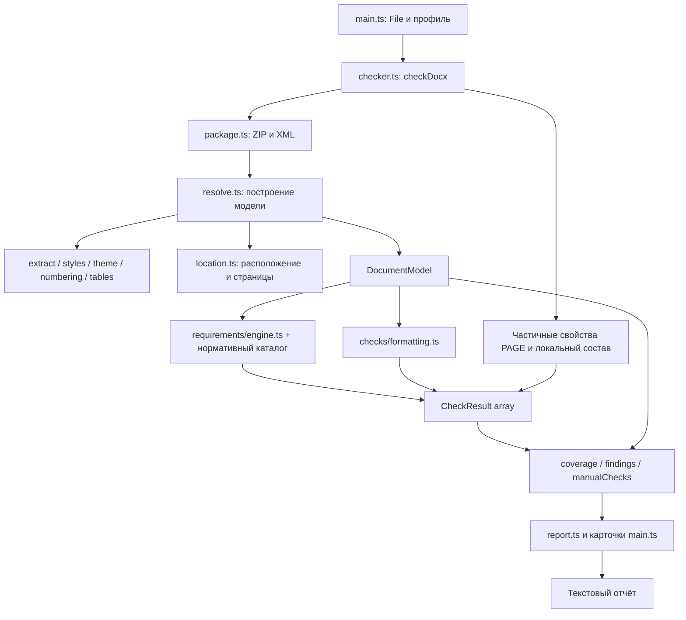

# Архитектура DockCheck

Документ описывает фактическую архитектуру текущей реализации с каталогом **stu-2021.1**. Пользовательские
возможности, запуск и ограничения собраны в [README.md](README.md). Здесь
рассматриваются ответственность модулей, поток данных, контракты и точки развития.

## 1. Границы системы

DockCheck — клиентское приложение на TypeScript. Интерфейс работает напрямую с DOM,
без UI-фреймворка. Vite обслуживает разработку и собирает статические ресурсы.
DOCX разбирается локально как ZIP-пакет OOXML; сервер обработки документов отсутствует.

В текущей системе нет базы данных, фонового сервиса, очереди заданий, авторизации,
облачной обработки, движка вёрстки или записи исправленного DOCX. Word COM,
LibreOffice и коммерческие SDK не являются зависимостями анализа.

Анализ выполняется в основном потоке браузера. Web Worker, потоковая обработка
архива и отмена выполняющегося анализа пока не реализованы. Общий объём работы
зависит от количества XML-частей, абзацев, runs, стилей и условных областей таблиц.
Ограничение 25 МиБ применяется интерфейсом к входному файлу; публичный `checkDocx`
сам по себе не повторяет эту проверку и не является ограничителем распаковки ZIP.

## 2. Стек и зависимости

| Компонент | Ответственность |
| --- | --- |
| TypeScript | Типы модели, профиля и отчёта; strict-проверка при сборке |
| Vite | Dev server и сборка браузерного приложения |
| JSZip | Чтение ZIP-контейнера DOCX; генерация синтетических фикстур в тестах |
| `@xmldom/xmldom` | Разбор XML и DOM API, общий для браузера и Node-тестов |
| Vitest | Проверки анализатора, правил, диапазонов и экспорта в Node |
| Playwright, внешний для проекта | Отдельный сценарий проверки интерфейса в Chromium |

Точные установленные версии фиксирует `package-lock.json`. В `package.json`
указаны диапазоны зависимостей. Playwright в манифест проекта не добавлен.

## 3. Структура репозитория

```text
index.html                       # HTML-точка входа и контейнер приложения
src/
  main.ts                        # Состояние UI, события, загрузка и карточки
  styles.css                     # Оформление, адаптивность и фокус
  types.ts                       # Requirements, CheckResult, Finding, CheckReport
  checker.ts                     # Публичный checkDocx и сбор отчёта
  report.ts                      # Представление, группировка, текстовый экспорт
  requirements/                  # Каталог, профиль, матрица, движок и индекс PDF
  profiles/
    default.ts                   # Начальный настраиваемый профиль
  checks/
    formatting.ts                # Сравнение DocumentModel с Requirements
  analyzer/
    model.ts                     # Свойства, runs, абзацы, секции, расположение
    package.ts                   # ZIP, XML, relationships и проверки упаковки
    extract.ts                   # Извлечение явных свойств и единиц
    properties.ts                # Наложение свойств и специальные каскады
    styles.ts                    # Индекс стилей, defaults, basedOn, переключатели
    theme.ts                     # Назначенные шрифты и тематические цвета
    numbering.ts                 # Определения и настройки списков
    tables.ts                    # Условные стили и прямая геометрия таблиц
    location.ts                  # Человекочитаемый путь и ориентиры страниц
    structure.ts                 # Кандидаты структуры и ограниченные счётчики
    resolve.ts                   # Обход частей и построение DocumentModel
scripts/
  check-ui.mjs                   # Самостоятельный браузерный сценарий
tests/                           # Тесты и синтетические документы
  checker.test.ts                # Исходные сценарии и комплектные DOCX
  location.test.ts               # Диапазоны, страницы, поиск и экспорт
  resolution.test.ts             # Каскады, темы, таблицы, списки, поля и ограничения
  helpers.ts                     # Упаковка синтетического OPC для тестов
  fixtures/
    generate.mjs                 # correct / incorrect / partial
    generate-search.mjs          # search / textbox
    *.docx                       # Пять комплектных синтетических документов
vite.config.ts                   # Порты сервера и Node-среда тестов
tsconfig.json                    # strict, ES2022, DOM, noEmit
```

`AGENT.md` — локальное задание, исключённое из Git. Его не следует включать в
поставку или использовать вместо публичной документации. `dist/` — результат
сборки, а `node_modules/` — установленные зависимости.

## 4. Сквозной поток данных



Последовательность одного запуска:

1. `main.ts` проверяет расширение и размер файла, показывает состояние обработки
   и получает `ArrayBuffer` через File API.
2. `checkDocx` открывает пакет и передаёт его в `analyze`.
3. `analyze` читает связанные определения, обходит текстовые области, разрешает
   свойства и сохраняет расположение каждого анализируемого фрагмента.
4. После обхода уточняются контексты колонтитулов, подписи и ориентиры страниц.
5. `checks` получает сравнения свойств; `evaluateRequirements` отдельно проверяет применимость и доказательства норм. Оба слоя не читают XML.
6. `checker.ts` дополняет результаты частичными свойствами PAGE и локальным составом,
   подсчитывает статусы и создаёт совместимые представления замечаний.
7. UI фильтрует результаты и группирует их для показа. Экспорт заново проходит
   полный массив результатов, сохраняя успешные и неизвестные проверки.

Исключение на этапе открытия/разбора возвращается вызывающему коду. Интерфейс
перехватывает его, возвращает загрузку и показывает сообщение. Поддерживаемая
частичная неопределённость обычно становится unknown, а не исключением.

## 5. Публичный API, нормативные данные и профиль

```ts
checkDocx(data: ArrayBuffer | Uint8Array, input: WorkProfile | Requirements = DEFAULT_PROFILE): Promise<CheckReport>
```

Имя файла добавляет UI, время отчёта формирует checker. Профиль валидируется
до открытия пакета. Неизвестные данные не подменяются ожидаемыми значениями.
Явно переданный старый `Requirements` преобразуется в локальное сравнение с
происхождением `legacy-api`. Начальный новый профиль не задаёт вид работы,
носитель или режим рамки без пользовательского подтверждения.

`requirements/schema.ts` определяет Rule, Assertion, Condition, Modality,
NormSource и CoverageRow. Условия: always, eq, in, not, all, any. Логика
трёхзначная; неизвестное условие не превращается в false. Валидатор проверяет
источники, типы, единицы известных свойств, id, ссылки, циклы зависимостей и
несовместимые утверждения с одинаковой областью. Это не решатель произвольных
логических противоречий между различными условиями.

Каталог и вложенные данные заморожены. Поля каждой нормы включают источник
редакции/пункта/страницы/формы, модальность, target/selector, утверждение,
исключения, альтернативы, зависимости и необходимые доказательства. Relation
сохраняет формальное отношение, для которого нужен отдельный валидатор; текст
relation не исполняется и не считается реализованным предикатом.

`COVERAGE` хранит семантические решения; `EXCLUSIONS` не порождает unknown.
`source-index.json` содержит SHA-256 PDF, локаторы и хеши 400 фрагментов 61
страницы. Текст исходного нормативного PDF не распространяется. `sourceCoverage.ts`
связывает блоки с решениями на уровне пункта, включая смешанные исключения.
Связность не доказывает экспертную полноту интерпретации. Размеры схем перенесены
с изображений, арифметические суммы проверены; полная независимая геометрическая
сверка не завершена. Внешние ГОСТы описаны как зависимости без полного текста
и без валидатора; редакции не обновляются автоматически.

`WorkProfile` (`schemaVersion: 2`) содержит id/версию, ссылку на каталог,
вид работы, режим, систему документации, специальность/код, состав с источником,
наличие материалов, согласование, способы нумерации и группировки, реквизиты,
локальные дополнения. Необязательные artifactManifest/externalEvidence хранят
заявленный комплект и пользовательские свидетельства отдельно от фактов DOCX.
Они не запускают автоматическое подтверждение соответствия внешнего файла.

Локальные дополнения имеют собственные id, источник и объяснение. Исходные
результаты СТУ сохраняются рядом с локальными; конфликт не меняет редакцию нормы.
Старый формат оформления доступен только как явно обозначенный локальный шаблон.
`requireContentsOverPages` удалён; содержание до 24 страниц — рекомендация,
которая требует подтверждённой пагинации. Начальный requiredSections пуст.

## 6. Контракты модели

### 6.1. Свойства и происхождение

`ResolvedProperty<T>` содержит:

| Поле | Смысл |
| --- | --- |
| `value` | Нормализованное значение либо null |
| `status` | resolved / unknown / unsupported |
| `source` | Часть, свойство и при наличии styleId/nodeId |
| `unit` | Единица нормализованного значения |
| `raw` | Исходное значение атрибута, когда оно сохранено извлечением |
| `reason` | Причина неопределённости или пояснение назначения |

`Properties` — словарь свойств. `complete` добавляет отсутствующим ключам unknown;
он не подставляет шрифт, размер или отступ из требований. Булево false является
значением, а не отсутствием свойства.

Статус свойства и статус проверки различаются. Свойство может быть resolved,
но соответствие оставаться unknown, если область профиля не установлена.
Например, размер сноски известен, но роль `note` не выбрана для общего кегля.

`explicit` хранит извлечённые локальные свойства, `properties` — результат
разрешения. Происхождение составного значения сейчас ограничено одним `Source`:
полного дерева вкладов всех слоёв нет. Это особенно существенно для объединённых
табуляций и сложных каскадов.

### 6.2. Документ, абзац и run

`DocumentModel` содержит `paragraphs`, `sections`, `objects`, `unsupported`,
`limitations`, счётчики таблиц/рисунков и необязательную `structure`.
`structure.ts` сохраняет кандидаты элементов и дерева заголовков, области
приложений, библиографические строки и лексические отсылки с исходными
диапазонами UTF-16. Confidence candidate не подтверждает структурную функцию.
Paragraph.roleEvidence хранится отдельно от оформления. OMML добавляется
объектом formula с representation/text; неподдержанная геометрия фиксируется
явно. Номера формул/объектов и достоверная структура пока не вычисляются.

`Paragraph` хранит текстовую проекцию, роль, идентификатор, расположение, runs,
явные/итоговые свойства, смещения сохранённых разрывов, признак PAGE и состояние
разбора полей. Роли: body, heading, table, footer, header, note, list, caption,
textbox, unknown. Классификация эвристическая и не доказывает семантику текста.

`Run` содержит собственный идентификатор, текст, расположение, свойства и
`fontRanges`. Последние позволяют проверять разные назначения шрифта внутри
одного run без потери исходных смещений. Размер шрифта проверяется на уровне run.

`Section` содержит свойства и словари действующих верхних/нижних колонтитулов.
`objects` сохраняет таблицы, строки, ячейки и обнаруженные drawing, включая
прямую геометрию и связь с кандидатом подписи. Это аналитическая модель, а не
схема для обратной сериализации всего DOCX.

`unsupported` хранит конкретные непроверенные объекты с расположением и причиной.
`limitations` — общие пояснения; отдельные причины могут присутствовать и в
объектном, и в общем представлении. Счётчики отчёта считают результаты правил,
а не уникальные причины или страницы документа.

### 6.3. Расположение и диапазоны

`DocumentLocation` — общее структурированное расположение:

- часть DOCX и область;
- XML-путь, если построен;
- paragraphId и номер абзаца внутри соответствующей области;
- storyId для отдельной текстовой истории;
- tablePath для вложенных таблиц с номерами строк/ячеек;
- fragmentId для run;
- секция либо sectionUses для повторно используемых колонтитулов;
- диапазон и отдельная ссылка на страницу.

Диапазон задаётся как `[start, end)` в **кодовых единицах UTF-16** исходной
анализируемой проекции абзаца. Это соответствует JavaScript `slice`.
Текст не trim-ится и не нормализуется перед расчётом. Emoji может занимать две
единицы; таб и разрыв строки сохраняются как `\t` и `\n`.

Цитата получается срезом по диапазону, а не поиском первого совпадения текста.
Идентификаторы служат для связи объектов внутри одного анализа; гарантии
сохранения идентификаторов после редактирования и повторного анализа файла нет.
Текст исключённых правок не входит в эту проекцию, а исключённая область
сохраняется отдельно. Исходная XML-позиция и текстовая позиция — разные понятия.

## 7. Упаковка и разбор XML

`package.ts` предоставляет чтение частей и helpers `children`, `all`, `child`,
`attr`. WordprocessingML выбирается по пространству имён, а не по XML-префиксу.

Основная часть ожидается по пути `word/document.xml`; root relationships должен
указывать на неё как officeDocument. Другие допустимые размещения основной части
не поддерживаются. Проверяются Content Types, основные типы relationships,
пространство имён relationships и корни поддерживаемых существующих частей.
Относительные Target нормализуются; выход выше корня пакета отклоняется.
Внешние relationships не загружаются.

`parse` собирает предупреждения и ошибки XML-парсера и отклоняет повреждённый XML.
Проверки упаковки не заменяют полную валидацию XML-схем и всех ограничений OPC.
Отсутствующая связанная часть может дать ограничение анализа; неверный Content Type
или корень существующей поддерживаемой части может прервать открытие пакета.

Чтение частей и разрешение некоторых стилей повторяются в нескольких местах;
универсального кэша и предварительно построенного индекса всех отношений нет.
Это точка оптимизации при работе с большими документами.

## 8. Разрешение оформления

### 8.1. Явные значения и единицы

`extract.ts` читает поддерживаемые свойства pPr/rPr/sectPr. Числовые атрибуты
проверяются на допустимую целочисленную запись и конечность. On/off-значения
отличаются от отсутствующих атрибутов: наличие spacing не означает включение
beforeAutospacing/afterAutospacing.

Основные преобразования: twips → мм, half-points → пт, twentieths of a point → пт.
Межстрочный `line` сохраняется с режимом; только `auto` сравнивается как `line/240`.
Исходная единица или смысл enum не должны подменяться миллиметрами.

### 8.2. Стили и специальные каскады

`styles.ts` индексирует styleId, тип, basedOn и свойства. Цепочки проверяются на
циклы, отсутствующие ссылки и несоответствие ожидаемому типу. Для bold/italic
вычисляется чётность переключателей, которая затем применяется к предыдущему
слою; прямое оформление трактуется как абсолютное значение.

`properties.ts` реализует `overlay` и `applyStyle`: взаимное исключение
firstLine/hanging, сброс тематической ссылки при прямом шрифте, атомарное
переопределение цвета и объединение табуляций по позиции с обработкой clear.

В `resolve.ts` свойства абзаца собираются из defaults, таблицы, paragraph style,
настроек списка при наличии и прямого pPr. Для текстового run учитываются defaults,
табличный и paragraph style, character style и прямой rPr. Параметры rPr уровня
списка извлекаются отдельно и не подставляются всему тексту пункта как оформление
символа нумерации. Это ограниченная реализация каскада, а не полный движок OOXML.

### 8.3. Темы и шрифты

`theme.ts` выбирает слот ascii/hAnsi/eastAsia/cs по тексту. Тематическая ссылка
разрешается через major/minorFont, а для поддержанного подмножества — supplemental
font и язык. `fontRanges` уточняют соответствие шрифта конкретному диапазону.

resolved означает назначенное семейство по OOXML. Наличие файла шрифта в системе,
реальный fallback, shaping, hint и все правила bidi не устанавливаются.
Сложные скрипты обрабатываются консервативно; szCs извлекается, но полное
разрешение размеров для Arab/Hebr не завершено.

Тематический цвет разрешается через clrScheme, aliases и srgbClr либо lastClr.
Tint/shade преобразуют светлоту HSL; tint имеет приоритет. Это вычисляемое RGB,
которое может отличаться округлением от Word. Правила сравнения цветов с профилем
пока отсутствуют.

### 8.4. Таблицы

`tables.ts` находит ближайшую таблицу и её цепочку стилей. Условные области
разрешаются с учётом наследования, tblLook, cnfStyle, размеров полос, позиции
строки/колонки и gridSpan. Текущий порядок применения: база, wholeTable,
горизонтальные полосы, вертикальные полосы, крайние колонки, крайние строки, углы.

vMerge и старый hMerge делают условное оформление недостоверным в заявленной
области поддержки. Цикл, отсутствующий/неверный тип стиля или изменения свойств
также приводят к unsupported, а не к подтверждению частично разрешённого значения.

`tableGeometry` сохраняет исходные свойства и часть нормализованных **прямых**
параметров. Проценты, dxa, auto и nil различаются. Наследование геометрии и полный
алгоритм конфликтов границ не реализованы. Самостоятельных требований профиля
к ширинам, границам и высотам нет.

### 8.5. Списки

`numbering.ts` связывает numId с abstractNum, выбирает уровень и lvlOverride,
учитывает startOverride, numStyleLink и связь с numbering style. Есть защита от
циклических ссылок. Возвращаются p/r-свойства и параметры формата/текста/старта/
перезапуска.

После обхода `structure.ts` вычисляет видимый номер только для одноуровневого
decimal с явным стартом и шаблоном %1, %1. или %1). Состояние разделено по
части, истории и numId. Неподдержанный уровень/формат блокирует дальнейший
счёт этой цепочки. Полного автомата перезапусков и составных номеров нет.
`list.number` остаётся unknown относительно нормативного оформления:
вычисленный счётчик сам по себе не доказывает правильность перечисления.

## 9. Обход частей, поля и правки

`resolve.ts` координирует анализ и строит модель. Текст p собирается собственным
обходом runs, включая hyperlink и content controls. Вложенные абзацы и txbxContent
не добавляются в текст родительского абзаца; текстовые блоки обходятся отдельно.
Choice/Fallback внутри AlternateContent не интерпретируются как два экземпляра
одного текста. Неподдержанная оболочка остаётся непроверенным объектом.

Секции определяются по sectPr, исключая старые sectPr внутри блоков изменений.
Верхние и нижние ссылки наследуются раздельно. titlePg и evenAndOddHeaders
ограничивают активные варианты. Используемая часть может иметь несколько
sectionUses и анализируется один раз. PAGE проверяется для контекста каждого
соответствующего раздела/варианта. Связанные используемые сноски отбираются по
reference id; разделители сносок не считаются обычным текстом.

Составные поля разбираются стеком внутри абзаца. Инструкция PAGE может состоять
из нескольких instrText. Неполная, одиночная или вложенная конструкция считается
неподдержанной. Движка вычисления полей и межабзацного автомата нет.

Политика правок — не принимать их автоматически. ins/del/move исключаются с
объяснением; изменённые свойства дают unsupported; изменённые строки таблиц
пропускаются. Полной модели всех видов исправлений нет. Неизвестное пространство
имён или неподдержанная конструкция сохраняются как ограничение с расположением.

## 10. Модель страниц

`PageReference` — discriminated union:

| status / source | Данные и смысл |
| --- | --- |
| confirmed / compatible-layout | Физический номер, полученный совместимой вёрсткой; текущая реализация не создаёт такие значения |
| saved / lastRenderedPageBreak | Приблизительный физический номер по ограниченному участку сохранённых маркеров |
| unknown / none | Причина отсутствия достоверного ориентира |

`printed` предусмотрен отдельно от physical, но печатные номера сейчас не
вычисляются. `pageNumberStart` и `pageNumberFormat` — свойства секции, а не
результат вычисления номера конкретного диапазона.

`assignSavedPages` строит упорядоченные позиции lastRenderedPageBreak в основном
документе, исключая текстовые блоки. Для границы диапазона двоичным поиском
находится предыдущий маркер и проверяется наличие следующего. Нужны обе границы;
до первого и после последнего ориентира нет. В позиции маркера run разделяется.
Для всего абзаца, пересекающего маркер, единый номер не выдаётся.

Явные page break, pageBreakBefore, несколько секций и зарегистрированное
неподдержанное содержимое консервативно отключают ориентиры. Эти источники не
суммируются. Тип секционного разрыва не превращается в точный номер, а сохранённое
число страниц из метаданных не используется как доказательство.

`locationLabel` и `pageLabel` формируют представление. Проверки и экспорт хранят
сам объект расположения, поэтому готовая строка не является единственным
источником данных.

## 11. Проверки, возможности и доказательства

`requirements/engine.ts` получает только DocumentModel, WorkProfile и сравнения
разрешённых свойств. Применимость, факт и предикат разделены. `RULE_SUPPORT`
и `IMPLEMENTATIONS` показывают фактическую степень реализации, а не одно
извлечение свойства. Для relation/pattern без выделенного валидатора возвращается
unknown. Исключения имеют приоритет; неизвестное исключение сохраняет unknown.

Начальная поддержка охватывает контекст выбора рамки/формы Ж, обе ориентации
полей, рекомендации шрифта/кегля таблиц и частичные сравнения основного текста.
Неустановленная роль основного текста не допускает нормативных pass/fail.
Размер A4 сохраняется как факт; без подтверждённой области приложений
нормативная оценка остаётся unknown. Внешние материалы, структура, геометрия,
словари и вёрстка остаются отдельными необходимыми возможностями.

Технические погрешности объявлены в TOLERANCE: fontPt 0,01; mm 0,02;
line 1/240 + малая поправка. Предикат полей и метаданные синхронизированы.
Нормативные отклонения этими числами не устанавливаются. Альбомные поля
20/20/30/10 мм отличаются от вертикальных 30/10/20/20 мм.

CheckResult сохраняет normative source отдельно от OOXML source, версию
профиля, origin (standard/local/analysis), модальность, применимость,
reasonCode, evidence, расположение/цитату/факт/ожидание и рекомендацию.
Причины: unknown_context, ambiguous_role, missing_fact, unsupported,
needs_layout, external_standard, external_artifact, unimplemented.

Разрешения сами по себе не требуют конструкции. Выбор Ж проверяется отдельной
обязательной нормой о числе консультантов. Отклонения рекомендаций не включаются
в findings обязательных нарушений. Полнота нумерации не выводится из поля PAGE:
его абзац остаётся отдельным частичным наблюдением.

`checker.ts` собирает все results, coverage по статусам, уникальные нормы
catalogCoverage, локальные конфликты, findings и manualChecks. Общий coverage
смешивает результаты по местам и не является процентом покрытия стандарта.
Текущая модель сохраняется в отчёте. `estimatedPages` не заполняется.

## 12. UI, сохранение и экспорт

main.ts хранит профиль, отчёт, файл для пересчёта, фильтр и номер запроса анализа.
Номер защищает от перезаписи результата устаревшим параллельным запуском.
После изменения профиля старый отчёт помечается stale, затем пересчитывается
с видимым состоянием обработки. Исходный файл остаётся только в памяти.

Настройки сгруппированы по контексту, составу, комплекту, нумерации, оформлению
и локальным требованиям. Неизвестный контекст допустим. Поля согласования
скрываются для известных видов вне ВКР. Реквизиты/комплект/доказательства и
локальные дополнения доступны как декларативные JSON-данные.

localStorage содержит только профиль под ключом dockcheck-work-profile-v2.
Миграция старого ключа явная: форматирование становится локальным, список
обязательных разделов и порог содержания сбрасываются с объяснением. Неполный
либо повреждённый импорт целиком отклоняется, поверхностного merge с defaults нет.

Отчёт показывает происхождение, профиль/версию, пробелы контекста, конфликты,
состояние реализации и отдельно рекомендации. Неизвестные нормативные результаты
группируются по reasonCode и изначально свёрнуты. Все исходные результаты
сохраняются для экспорта. HTML экранирует введённые строки; копирование берёт
срез исходного абзаца. Диалог поддерживает фокус, Escape и циклический Tab.

Текстовый экспорт сохраняет все результаты и доказательства, JSON-экспорт —
полный отчёт в оболочке schemaVersion 1. Профиль экспортируется с его schemaVersion
2. Каталог/матрица/индекс выгружаются отдельным JSON; модуль индекса загружается
по запросу. Формат исправленного DOCX отсутствует.

## 13. Проверки и воспроизводимость

```sh
npm test
npm run build
```

93 теста сохраняют прежние сценарии каскадов, тем, таблиц, секций, PAGE,
правок, диапазонов/Unicode и страниц. Прежние тесты сравнения свойств явно
используют совместимый локальный Requirements. Новые тесты проверяют начальный
нормативный профиль, каталог/матрицу/индекс, условия/исключения, альтернативы,
модальности, ориентации, конфликты, титульные формы всех видов работ,
миграцию, экспорт, причины неопределённости и ограниченные счётчики.

Пять старых комплектных DOCX синтетические. Новый onlyoffice-reference.docx
создан установленным x2t из явно заданного editor-reference.rtf и прочитан
конвертером обратно. Проверяемые ожидаемые свойства заданы в RTF независимо
от анализатора. Версия, хеши и границы проверки записаны в
[tests/fixtures/ONLYOFFICE.md](tests/fixtures/ONLYOFFICE.md).
Открытие в GUI реального редактора, эталонный рендер и подтверждённая
пагинация не выполнены; попытка PDF-рендера установленного движка завершилась
ошибкой. Фикстура не является эталоном геометрии Word.

scripts/check-ui.mjs выполняется отдельно с внешним Playwright/Chromium.
Проверяет загрузку пяти фикстур, цитаты/буфер, диапазоны/страницы, фильтры,
локальный профиль, консервативный исходный профиль, клавиатуру, 390 px,
контекст ВКР, версию/пересчёт, повреждённый импорт и оба экспорта. Также
проверяет отсутствие передачи документа. Артефакты записываются в /tmp.

## 14. Незавершённые возможности

Каталог не равен автоматическому валидатору всего СТУ. Структура, специальные
роли, нумерация объектов/многоуровневых списков, формулы, библиографические
схемы/связи, геометрия рамок, словари и отдельные артефакты требуют дальнейших
реализаций; нормы сохранены с unknown. Нет экспертной независимой сверки
каждой интерпретации PDF и всех деталей схем.

Подтверждённая пагинация требует отдельного совместимого источника с картой
объектов, версиями шрифтов и проверенным отображением. Сохранённые разрывы,
метаданные и PDF без карты исходного DOCX не заменяют такой источник.
Адаптеры чертежей/слайдов и внешних нормативов проектируются отдельно;
серверный анализ, внешний рендер и загрузка пользовательских файлов не добавлены.

При расширении свойства сохранять независимые ожидаемые значения, raw/единицу/
источник, семантику каскада, исходные диапазоны и явные unsupported. Реализацию
проверки добавлять только при доказанных применимости и фактах, затем
синхронизировать реестр поддержки, матрицу, экспорт и документацию.
